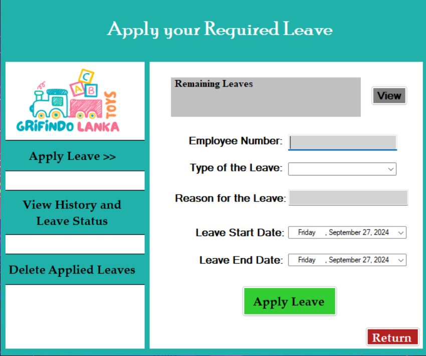
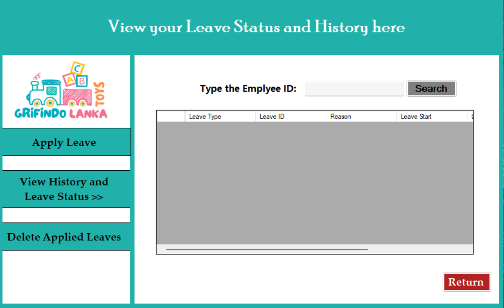
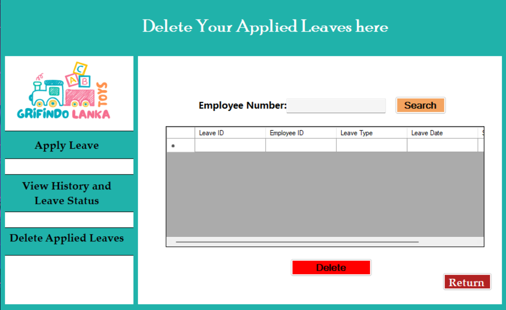
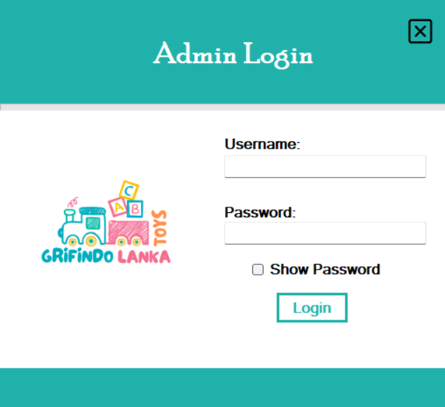
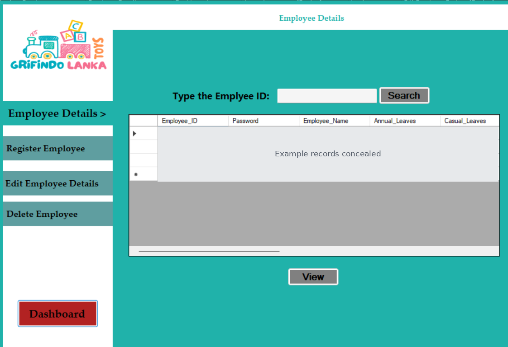
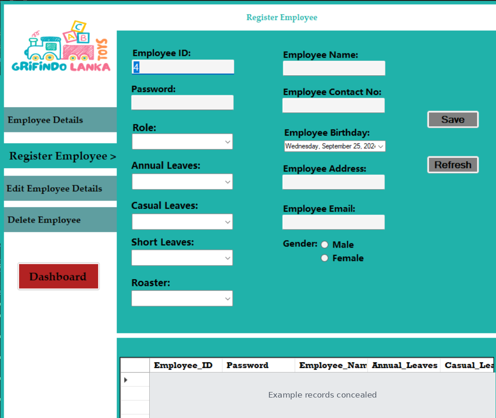
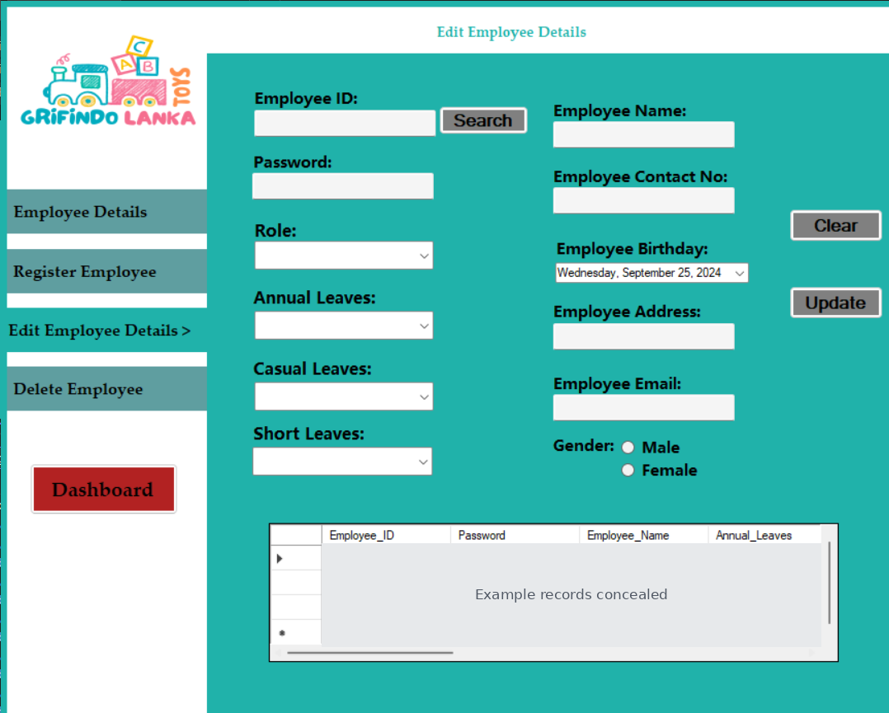
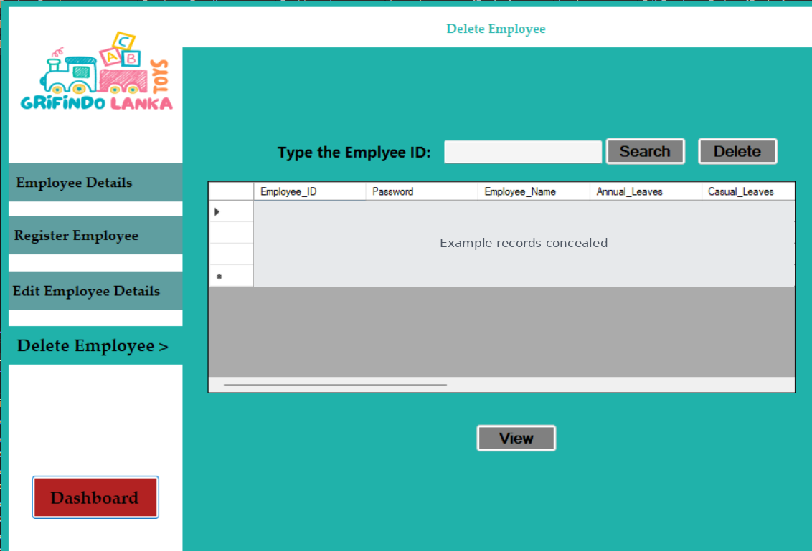
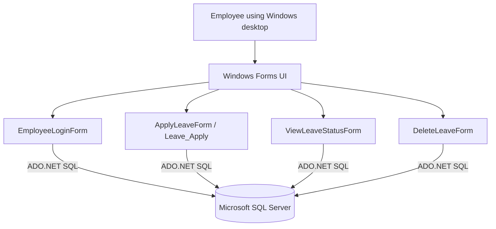

# Leave Management System

**An academic C# Windows Forms desktop application for submitting and viewing employee leave requests.**

**Author:** [Maleesha Dewmina Perera](https://github.com/MaleeshaDewmina)  
**Project type:** Programming coursework · Desktop application  
**Stack:** C# · .NET Framework 4.7.2 · Windows Forms · Microsoft SQL Server · ADO.NET

> **Portfolio note:** This repository preserves an educational implementation. It has known database and security limitations and has not been verified by a full Windows/SQL Server test run. See [Known Limitations](docs/KNOWN_LIMITATIONS.md).

## Academic project context

**Course:** Pearson BTEC Higher National Diploma in Computing · Unit 01 — Programming · September 2024. The assignment scenario was a leave-management system for *Grifindo Lanka Toys (Pvt) Ltd.*, with employee and admin roles. The source provided for this portfolio repository contains the **employee-side Windows Forms application**; admin-side screen evidence is from the original report and the corresponding project source has not been provided.

## Project at a glance

| Area | What the available source demonstrates |
| --- | --- |
| Authentication | Employee ID/password sign-in screen |
| Leave requests | A form that submits requested dates, leave type and reason |
| Viewing requests | Search for an employee's leave records |
| Record deletion | A separate leave-deletion interface (with important limitations) |
| Leave balance | A prototype remaining-leave calculation, separate from the request flow |

## Application screenshots (original 2024 assignment report)

The images below were **extracted from my original September 2024 Unit 01 Programming assignment report**, not generated or recreated. They illustrate the historical coursework prototype. Images containing example employee IDs, names or passwords have had the data **permanently covered** before publication. Screenshots are documentation evidence, **not proof that this source snapshot was recently compiled or executed**.

### Employee application — source included in this repository

| Employee sign-in | Apply for leave |
| :---: | :---: |
|  |  |
| **Leave history and status** | **Delete leave request** |
|  |  |

### Administrator application — historical report screenshots only

> **Important:** The submitted 2024 report documents a separate administrator application, but its **source code was not present in the supplied project ZIP**. The images below are shared for transparent historical documentation only. This repository does not claim to contain a runnable administrator application.

| Administrator login | Employee directory |
| :---: | :---: |
|  |  |
| **Employee registration** | **Edit employee details** |
|  |  |



See the [screenshot provenance and privacy notes](docs/screenshots/README.md) for the original report figure/page references.

## Conceptual system architecture



This describes the components present in the code; it is **not** a claim that all workflows are functioning end-to-end. See [Architecture Notes](docs/ARCHITECTURE.md) and [Database Model](docs/DATABASE_MODEL.md).

## Main screens and features

- **Employee login:** checks an employee ID and password in the `Employee_Details` database table.
- **Apply for leave:** chooses a leave type, provides a reason and date range, and submits the request to `TableLeave`.
- **View leave status:** searches leave requests by employee ID and displays records in a data grid.
- **Delete leave records:** provides a searchable deletion screen. The current implementation deletes *all* matching rows for an employee ID rather than a selected individual leave request; see limitations.
- **Leave balance prototype:** calculates annual, casual, and short leave allowances using date ranges and a separate `Leaves` table; this does not use the same table as the primary leave-submission workflow.
- **Windows Forms navigation:** login, main menu, apply, view status, and delete forms are present in the solution.

> **Scope:** This is a preserved academic coursework implementation, not a finished HR product. Source inspection found database-schema inconsistencies and security/validation issues. Features have not been verified through a complete end-to-end run.

## Technology stack

- **Language:** C#
- **UI:** Windows Forms
- **Framework:** .NET Framework 4.7.2
- **Database:** Microsoft SQL Server / SQL Server Express
- **Data access:** ADO.NET (`System.Data.SqlClient`) and generated typed DataSets/TableAdapters
- **IDE:** Microsoft Visual Studio (Windows)

## Getting started (local demonstration)

1. Install **Visual Studio** with the .NET desktop development workload and a **.NET Framework 4.7.2 targeting pack**.
2. Install SQL Server Express and SQL Server Management Studio (SSMS).
3. Open `database/setup.sql` in SSMS and review it. The script creates a **reconstructed starter schema** based on application SQL and the supplied XSD definitions; it is **not** an original database export and may require adjustments to your local application/data set.
4. Execute the script using a development-only SQL Server instance. It does not insert any accounts or employee records.
5. The supplied code has been normalised to the Windows-authenticated instance `localhost\SQLEXPRESS`. Change the connection strings for your local instance as needed. Connections are hardcoded in several `.cs` forms as well as `App.config`, generated settings and DataSet files.
6. Add **only fictitious demonstration employees** in your local database, including a throwaway employee password if login testing is necessary. **Never use a personal password.**
7. Open `LeaveManagementSystem.sln` in Visual Studio, build, and run `LeaveManagementSystem`.
8. Test each form and inspect SQL Server errors; see the limitations below.

## Directory structure

```
LeaveManagementSystem.sln
LeaveManagementSystem/
  Program.cs                 # application entry point
  EmployeeLoginForm.cs       # sign-in
  EmployeeMainForm.cs        # navigation
  ApplyLeaveForm.cs          # leave requests and prototype balance logic
  ViewLeaveStatusForm.cs     # search and status
  DeleteLeaveForm.cs         # leave deletion
  Leave_Apply.cs             # alternate leave-application form
  *Designer.cs, *.resx       # Windows Forms designer code and resources
  LeaveManagementSystemDataSet*.xsd # typed DataSet schemas
  App.config                 # development SQL Server configuration
  LeaveManagementSystem.csproj
  Properties/
database/setup.sql          # reconstructed local starter database schema
docs/KNOWN_LIMITATIONS.md
docs/ARCHITECTURE.md       # conceptual component diagram
docs/DATABASE_MODEL.md     # reconstructed schema and relationships
docs/screenshots/README.md # screenshot origin, captions, redactions
```

## Important limitations and recommended improvements

- **Security:** login SQL is constructed by concatenating input; passwords are compared in plaintext. Replace with parameterised queries and password hashing before any shared deployment.
- **Database consistency:** current forms use differently named tables (`TableLeave`, `Leaves`, `Leave_Table`, and `TableEmployee`). The original database backup was not included, so the reconstructed setup may not support all paths without further changes.
- **Data safety:** the delete screen can remove all leave records for an employee ID. Review deletion logic before testing with meaningful data.
- **Validation:** employee IDs are parsed using `int.Parse`; leave-type selection and date ordering need validation.
- **Prototype and unused code:** some event handlers are empty and the leave-balance logic is disconnected from the primary leave-request table. `LeaveForm.cs` is an incomplete prototype and is **not included** in the Visual Studio `.csproj`; it was omitted from this public-source preparation.
- **Testing:** code has been inspected but not compiled or run in a Windows / SQL Server environment during this repository preparation.

See [docs/KNOWN_LIMITATIONS.md](docs/KNOWN_LIMITATIONS.md) for additional specifics.

## Publication notes

The GitHub-ready archive excludes `.vs`, `bin`, `obj`, compiled `.exe`/`.dll`, debugger files, and machine-specific generated caches. Source-level references to the original local SQL Server computer were replaced with `localhost`. No actual employee database, SQL Server backup, or production credentials are included. Review any bundled designer resources for ownership/licensing before redistribution.

## Author and attribution

**Maleesha Dewmina Perera** — [GitHub profile](https://github.com/MaleeshaDewmina)

Developed as an academic programming project. Please credit additional collaborators or supervisors here only if their contributions are verified; the source archive does not establish other contributors. Documentation diagrams describe the inspected source and are not screenshots of a running application.
