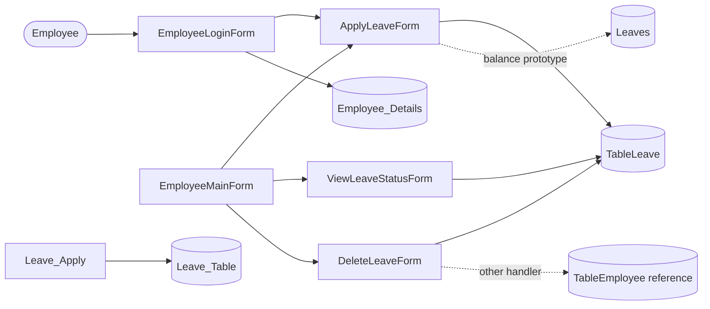

# Application architecture — source overview

This is a **conceptual, source-based** overview, not a verified runtime architecture or a new design imposed on the application.

## Components

- `EmployeeLoginForm.cs` — employee ID/password sign-in; the current version uses input concatenation and plaintext passwords, which must be fixed before any production use.
- `EmployeeMainForm.cs` — navigation form present in the solution.
- `ApplyLeaveForm.cs` — main leave-request form and a separate leave balance prototype.
- `ViewLeaveStatusForm.cs` — employee leave lookups.
- `DeleteLeaveForm.cs` — deletion flows; **one deletes all requests for a matching employee ID**, so do not test with important data.
- `Leave_Apply.cs` — alternative leave form using a different legacy table name.

## Architectural caveats

Current forms directly execute SQL with ADO.NET, and there is no consolidated repository/service layer. Multiple overlapping table names appear in the source. The SQL file is only a reconstructed local starter schema. For detailed caveats, see [Known Limitations](KNOWN_LIMITATIONS.md).
