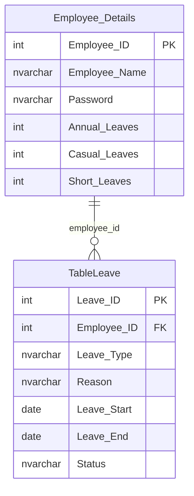

# Database schema — reconstructed coursework view

**Important:** The source did not include the original SQL Server database backup. This is an inferred view from the supplied C# code and XSD files and the development-only `database/setup.sql`, not an authoritative ERD of a production database.

## Additional tables referenced by legacy forms

- `Leave_Table` — an alternate form's leave storage.
- `Leaves` — leave balance prototype and some DataSet definitions (the definitions may not agree).
- `TableEmployee` — referenced by a delete handler but not reconciled with the reconstructed starter schema.

For a future production redesign, consolidate the employee and leave-request tables, use proper hashed credentials, employee-scoped access controls, date validation, and a per-leave-ID cancellation workflow. Those improvements have **not** been implemented in the preserved project.
